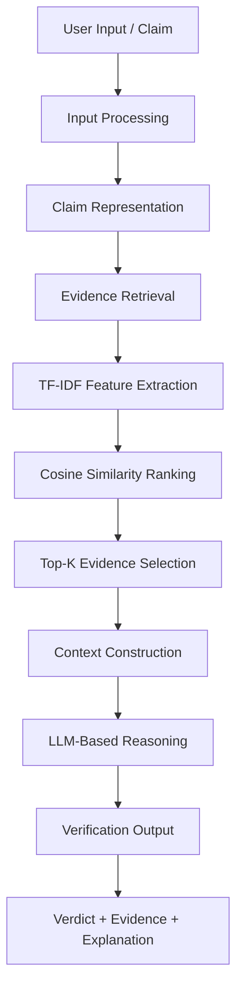

# 🔍 TraceVerify
### AI-Driven Explainable Misinformation Verification Using Retrieval-Augmented Generation (RAG)

<p align="center">

**Verify claims. Retrieve evidence. Understand the reasoning.**

</p>

---

## 📌 Overview

**TraceVerify** is an AI-powered misinformation verification system designed to analyze claims and provide evidence-based verification results through **Retrieval-Augmented Generation (RAG)** and Large Language Model (LLM) reasoning.

Instead of relying only on a classification label, TraceVerify combines information retrieval, evidence relevance ranking, and AI-generated explanations to help users understand the context behind a verification result.

The goal is to make misinformation verification more **transparent, explainable, and evidence-oriented**.

---

## 🎯 Objectives

- Detect and analyze potentially misleading information.
- Retrieve relevant supporting evidence.
- Rank retrieved evidence based on relevance.
- Utilize Large Language Models for contextual reasoning.
- Generate explainable verification results.
- Support informed decision-making through evidence-based analysis.

---

## ✨ Key Features

- 🤖 **AI-Based Verification** — Analyze claims using AI-based reasoning.
- 🔎 **Retrieval-Augmented Generation** — Retrieve relevant evidence before generating an explanation.
- 📚 **Evidence Retrieval** — Identify relevant contextual information.
- 📊 **Similarity-Based Ranking** — Rank evidence using TF-IDF and cosine similarity.
- 🧠 **LLM-Based Reasoning** — Generate contextual explanations using a Large Language Model.
- ⚖️ **Explainable Results** — Present verification outcomes with supporting context.
- 🖥️ **Interactive Interface** — User-friendly interface for interacting with the verification system.
- 📈 **Research & Methodology Dashboard** — Explore the dataset, methodology, algorithms, mathematical formulation, evaluation metrics, limitations, and future scope.

---

## 🏗️ System Architecture



---

## 🔬 Methodology

TraceVerify follows an evidence-oriented verification pipeline.

### 1. Input Processing
The system receives a claim or verification input and prepares it for analysis.

### 2. Text Preprocessing
Text is cleaned and normalized to improve retrieval and analysis.

### 3. Evidence Retrieval
Relevant information is retrieved from the available evidence collection.

### 4. Feature Extraction
TF-IDF is used to represent text based on its relevance within the corpus.

### 5. Similarity Computation
Cosine similarity is used to calculate similarity between the claim and retrieved evidence.

### 6. Evidence Ranking
Evidence items are ranked according to relevance scores, and the most relevant items are selected.

### 7. Context Construction
Selected evidence is combined into contextual information for the language model.

### 8. LLM-Based Reasoning
The language model analyzes the claim in relation to the retrieved evidence.

### 9. Verification Output
The system presents the verification result, retrieved evidence, and AI-generated explanation.

---

## 🧮 Algorithms Used

| Algorithm / Technique | Purpose |
|---|---|
| TF-IDF | Text representation and feature extraction |
| Cosine Similarity | Measuring claim-evidence similarity |
| Top-K Retrieval | Selecting the most relevant evidence |
| Retrieval-Augmented Generation (RAG) | Grounding LLM reasoning with retrieved context |
| Large Language Model (LLM) | Contextual analysis and explanation generation |

### TF-IDF

TF-IDF represents textual information by assigning importance to words based on their frequency within a document and their rarity across the corpus.

### Cosine Similarity

Cosine similarity measures the similarity between two vector representations.

\[
\text{Similarity}(A,B)=\frac{A\cdot B}{\|A\|\|B\|}
\]

### Top-K Evidence Retrieval

The system ranks evidence based on similarity and selects the top relevant items for contextual reasoning.

---

## 🧰 Technology Stack

### Programming Language
- Python

### AI & Machine Learning
- Scikit-learn
- TF-IDF
- Cosine Similarity
- Large Language Models

### Backend & Application
- Python-based verification pipeline
- Streamlit

### Data Processing
- Pandas
- NumPy

### Visualization
- Plotly
- Streamlit Charts

### LLM Integration
- Groq API
- OpenAI-compatible API integration

---

## 📂 Project Structure

```text
Multimodal_misinformation/
│
├── app/
│   └── traceverify_new.py
│
├── assets/
│   └── team/
│
├── src/
│   ├── image_understanding.py
│   └── llm_verifier.py
│
├── data/
│   ├── raw/
│   └── processed/
│
├── outputs/
│
├── requirements.txt
├── .gitignore
└── README.md
```

*The structure above represents the major project components; additional files and folders may exist in the repository.*

---

## 🚀 Getting Started

### Prerequisites

- Python 3.10+
- Git
- API key for the configured LLM provider, if required

### 1. Clone the Repository

```bash
git clone https://github.com/Tejaswini-2207/Multimodal-Misinformation-Verification.git
```

### 2. Navigate to the Project

```bash
cd Multimodal-Misinformation-Verification
```

### 3. Create a Virtual Environment

```bash
python -m venv venv
```

### 4. Activate the Environment

**Windows:**

```bash
venv\Scripts\activate
```

**Linux / macOS:**

```bash
source venv/bin/activate
```

### 5. Install Dependencies

```bash
pip install -r requirements.txt
```

### 6. Configure Environment Variables

Create a `.env` file in the project root and add the required API credentials.

```env
GROQ_API_KEY=your_api_key_here
```

⚠️ **Never upload API keys, passwords, or secrets to GitHub.**

### 7. Run the Application

```bash
streamlit run app/traceverify_new.py
```

---

## 📊 Research & Methodology

The Research & Methodology section covers:

- Project Overview
- Dataset Analysis
- Problem Statement
- Research Objectives
- System Methodology
- System Pipeline
- Retrieval-Augmented Generation
- Algorithms Used
- LLM-Based Reasoning
- Mathematical Formulation
- Verification Output
- Evaluation Metrics
- Results & Analysis
- Limitations
- Future Enhancements
- Conclusion

---

## 📈 Evaluation Metrics

The framework can be evaluated using standard classification metrics:

- Accuracy
- Precision
- Recall
- F1-Score
- Confusion Matrix

Actual experimental performance values should be reported using verified evaluation results.

---

## ⚠️ Limitations

- Verification quality depends on the relevance and reliability of retrieved evidence.
- The system may encounter incomplete or conflicting information.
- LLM-generated explanations may contain inaccuracies.
- Dataset class imbalance can influence evaluation.
- Automated verification should not replace independent fact-checking.
- Full multimodal verification depends on the integration and availability of image-analysis components.

---

## 🔮 Future Enhancements

- Integration of advanced vision-language models.
- Improved multimodal text-image verification.
- Expansion of reliable evidence sources.
- Real-time misinformation verification.
- Enhanced source credibility analysis.
- Improved retrieval and ranking methods.
- Larger and more balanced datasets.
- Advanced explainability mechanisms.
- Scalable deployment and performance optimization.

---

## 👩‍💻 Project

**TraceVerify**  
M.Tech Artificial Intelligence  
**Amrita Vishwa Vidyapeetham**

---

## 📜 Disclaimer

TraceVerify is an AI-assisted research project developed for misinformation analysis and verification. Its outputs are generated using automated retrieval and AI reasoning and should be independently verified before being treated as factual conclusions.

---

<p align="center">

**Built with Python, AI, Retrieval-Augmented Generation, and a focus on explainability.**

</p>
